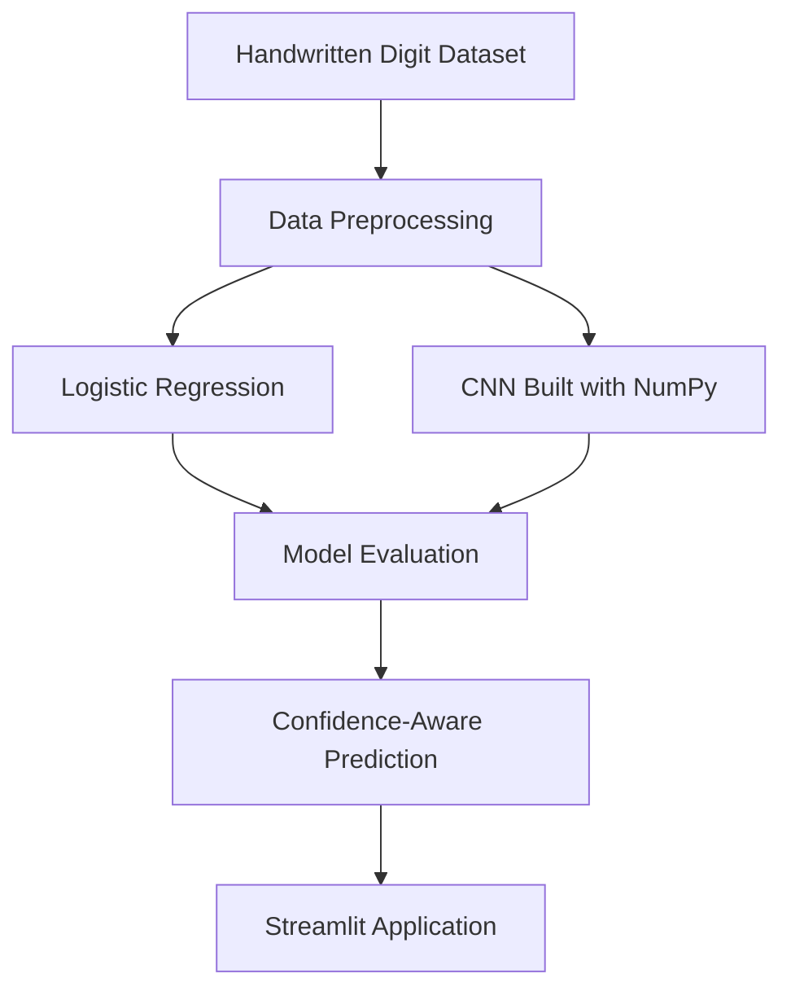
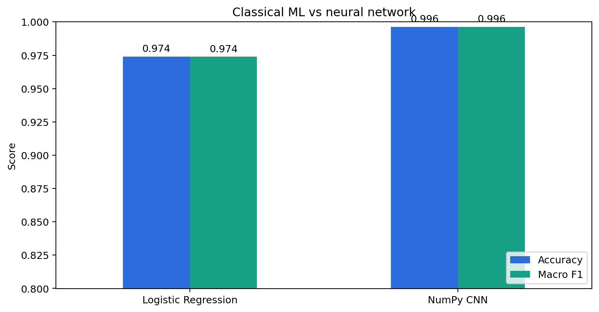
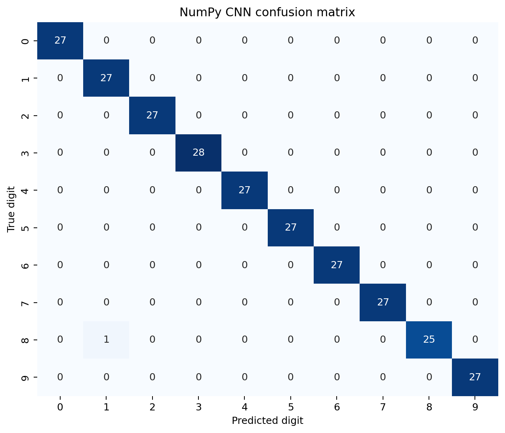
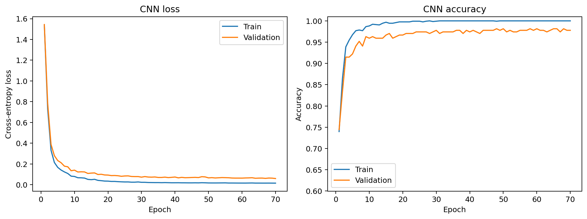
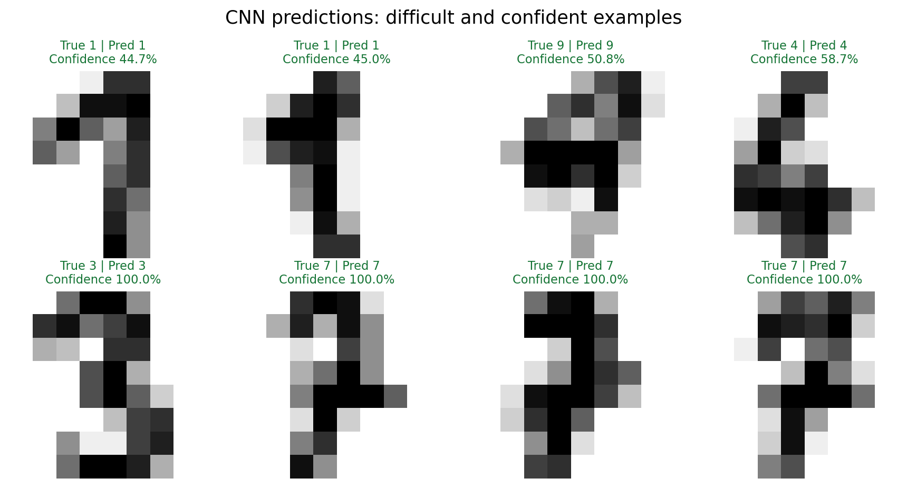

# NeuroOCR: Handwritten Digit Recognition


NeuroOCR is an end-to-end machine learning and deep learning project for recognizing handwritten digits from `0` to `9`.

The project compares a classical Logistic Regression model with a Convolutional Neural Network built from scratch using NumPy. It includes trained models, evaluation results, explainability visualizations, automated tests, an executed Jupyter Notebook, and an interactive Streamlit application.

## Project Results

| Model | Test Accuracy |
|---|---:|
| Logistic Regression | 97.41% |
| NumPy CNN | 99.63% |

Additional CNN results:

- Macro F1-score: **99.62%**
- Log Loss: **0.0363**
- Confidence Threshold: **0.85**
- Prediction Coverage: **96.30%**
- Accuracy on Accepted Predictions: **99.62%**

## Dataset

The project uses the Optical Recognition of Handwritten Digits dataset available through Scikit-learn.

- Total images: **1,797**
- Classes: **10 digits (`0–9`)**
- Image size: **8 × 8 pixels**
- Image type: **Grayscale**

## Project Architecture



## Main Features

- Real handwritten digit dataset
- Machine learning baseline using Logistic Regression
- CNN implemented from scratch using NumPy
- Model comparison and evaluation
- Confusion matrices and training curves
- Confidence-aware predictions
- Saliency-based explainability
- Saved trained models
- Executed Jupyter Notebook with outputs
- Interactive Streamlit application
- Automated tests and GitHub Actions workflow

## Project Structure

```text
neuroocr-handwritten-digit-recognition/
├── .github/workflows/       # Automated testing workflow
├── data/                    # Dataset information
├── models/                  # Saved trained models
├── notebooks/               # Executed end-to-end notebook
├── results/                 # Metrics, graphs and predictions
├── samples/                 # Sample digit images
├── src/                     # Core project source code
├── tests/                   # Automated tests
├── app.py                   # Streamlit application
├── predict.py               # Prediction script
├── train_project.py         # Model training pipeline
├── run_all.py               # Complete project execution
├── requirements.txt         # Python dependencies
├── MODEL_CARD.md            # Model information
└── LICENSE                  # MIT License
```

## Installation on Windows

Clone the repository:

```bash
git clone https://github.com/rushipatil1318-boop/neuroocr-handwritten-digit-recognition.git
cd neuroocr-handwritten-digit-recognition
```

Create and activate a virtual environment:

```bash
python -m venv .venv
.venv\Scripts\activate
```

Install the required packages:

```bash
pip install -r requirements.txt
```

## Run the Complete Project

```bash
python run_all.py
```

## Launch the Streamlit Application

```bash
streamlit run app.py
```

The application will open in your browser. Upload or select a handwritten digit image to view the predicted digit and confidence score.

## Jupyter Notebook

The complete executed notebook is available here:

[`notebooks/NeuroOCR_End_to_End.ipynb`](notebooks/NeuroOCR_End_to_End.ipynb)

It contains data exploration, model training, evaluation, visualizations and generated outputs.

## Visual Results

### Model Comparison



### CNN Confusion Matrix



### Training Performance



### Sample Predictions



## Testing

Run the automated tests using:

```bash
pytest
```

## Technologies Used

- Python
- NumPy
- Pandas
- Scikit-learn
- Matplotlib
- Seaborn
- Streamlit
- Jupyter Notebook
- Pytest
- GitHub Actions

## Author

**Rushikesh Patil**

M.Sc. Business Intelligence and Data Science  
Interested in Machine Learning, Deep Learning and AI Engineering.

## License

This project is available under the [MIT License](LICENSE).
